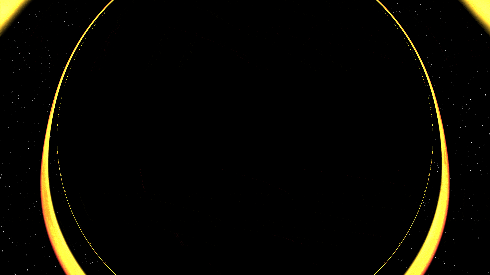

# Singularity

A real-time black hole renderer written in Rust (glium) with custom GLSL shaders. Light rays are traced through Schwarzschild spacetime to produce gravitational lensing and a lensed accretion disk, with a Flamm's paraboloid grid drawn alongside.



## Prerequisites

* **Rust** 1.85+ (the crate uses edition 2024) and Cargo
* An OpenGL-capable graphics driver
* **Nix** and **Direnv** (optional, for a reproducible environment)

## Building and Running

### Option 1: Nix and Direnv (recommended)

```bash
direnv allow
cargo run --release
```

### Option 2: Without Nix

Install the Rust toolchain plus the system libraries glium/winit need (OpenGL, X11 and/or Wayland, xkbcommon, and `pkg-config`), then:

```bash
cargo run --release
```

Always use `--release`. The fragment shader integrates a geodesic for every pixel, and debug builds make the Rust side needlessly slow.

## Controls

| Input | Action |
| --- | --- |
| Left mouse drag | Orbit the camera around the black hole |
| Scroll wheel | Zoom in / out |
| `G` | Toggle the Flamm's paraboloid grid |

## How It Works

The scene is a single fullscreen quad. For each pixel, the fragment shader (`shaders/quad.frag`) does the following:

1. Builds a camera ray from the camera position, basis vectors and field of view.
2. Reduces the ray to a 2D orbital plane and integrates the Schwarzschild null geodesic with RK4, using an adaptive step size that shrinks near the horizon.
3. Checks each step for a crossing of the equatorial plane inside the disk's radial range, and shades the hit with a temperature gradient, Doppler-style beaming, gravitational redshift and fBm turbulence.
4. Colors rays captured by the horizon black, and rays that escape get a procedural starfield.
5. Writes a real depth value at the hit point, so the 3D grid is correctly hidden behind the shadow and disk.

The grid (`shaders/grid.*`) is a mesh of Flamm's paraboloid, the embedding diagram of the spatial geometry, drawn after the quad with depth testing.


## Dependencies

Key crates: `glium` (OpenGL and windowing via winit), `glam` (vector/matrix math) and `image`. See `Cargo.toml` for the full list.

## Known Limitations

* The per-pixel RK4 integration is expensive, so expect low framerates on integrated graphics. Lower `MAX_STEPS` in `quad.frag` if it is too slow.
* The accretion disk uses a simplified color model, not full radiative transfer.
* Only a non-rotating (Schwarzschild) black hole is modeled.
